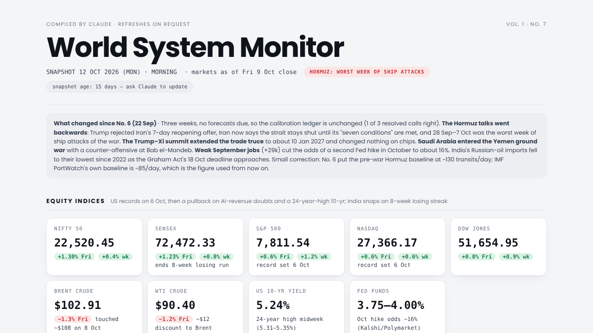
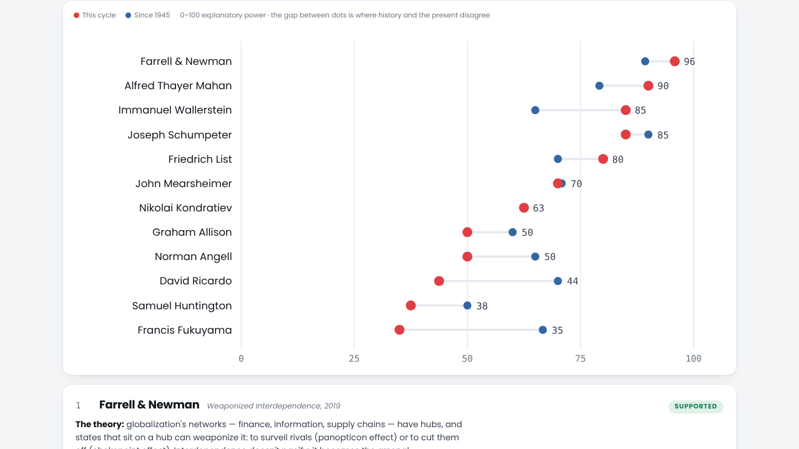
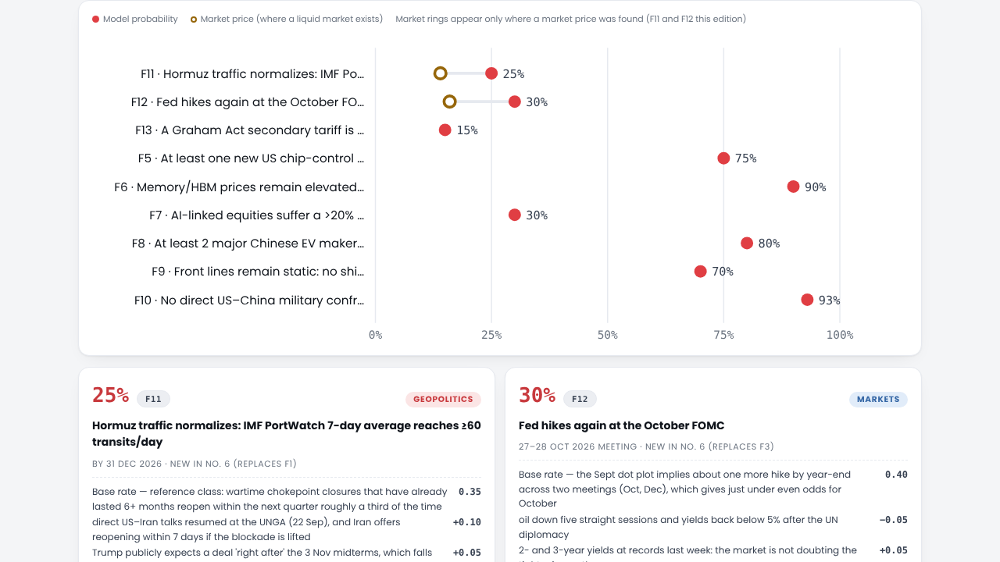

# World System Monitor

**A geopolitical and macro dashboard that tests 12 grand theories of world order against live data, publishes falsifiable forecasts, and scores its own accuracy.**

[](https://pavan20001999.github.io/world-system-monitor/)


[](LICENSE)



## What it does

Most dashboards show numbers. This one asks what the numbers *mean* for competing explanations of how the world works, and keeps score.

| Layer | What it shows |
|---|---|
| **Readings** | Equity indices (Nifty, Sensex, S&P, Nasdaq, Dow), crude, rates; container and dry-bulk freight (Drewry WCI, Baltic Dry); IATA traffic; AI capex and memory pricing; chip export controls; sanctions; trade deals; EV industrial policy; active conflicts |
| **Theory Scoreboard** | 12 thinkers (Mahan, Mearsheimer, Schumpeter, Wallerstein, List, Kondratiev, Angell, Ricardo, Huntington, Allison, Fukuyama, Farrell & Newman), each broken into a core claim and auxiliary predictions, scored against this cycle's readings *and* a post-1945 historical record |
| **Forecast Board** | Base-rate forecasts with itemized adjustments, deadlines and falsifiers; prediction-market cross-checks; resolved forecasts are Brier-scored in a public calibration ledger |
| **Risk boards** | Country Instability Index (CII v8 formula), Comprehensive National Power (the CCP's own power doctrine), a 90-day conflict escalation table, a 7-signal market radar and a composite stress index |
| **Data Ledger** | Every model input, its value, its source link, and which scores it feeds |

## Why it's built this way

- **Computed, not judged.** Every score, verdict, rank and chart is calculated in the browser from datasets in the page. Change one coding and everything downstream recomputes.
- **Fixed model, moving world.** Indicators, weights, the scoring rubric and thresholds stay fixed between editions, so score changes reflect the world rather than model drift.
- **Accountable forecasting.** Forecasts carry IDs, deadlines and falsifiers fixed at publication. Misses stay on the ledger (edition No. 6 resolved three: one right, a 0.327 Brier score, and an explanation of why).
- **Corrections in the open.** Errors found in later editions are called out on the page, not silently patched.



## The core formulas

```
Theory score     S   = 100 · Σ(wᵢ·oᵢ) / Σwᵢ        o ∈ {1, .75, .5, .25, 0}, w = 2 core / 1 auxiliary
Forecast         p   = clamp(base_rate + Σ adjustments, 0.02, 0.98)
Market blend     p*  = extremize(mean(model, market), a = 1.73)      (Good Judgment Project)
Calibration      BS  = mean((p − outcome)²)
Instability      CII = 0.40·baseline + 0.60·(0.25U + 0.30C + 0.20S + 0.25I) + boosts, floored for active wars
National power   CNP = Σ wᵢ·cᵢ over Huang Shuofeng's seven components
```

Full details are in [docs/METHODOLOGY.md](docs/METHODOLOGY.md).



## Run it

No build step and no dependencies to install. Open `index.html` in a browser, or serve the folder:

```bash
python -m http.server 8000
# then open http://localhost:8000
```

The only external request is Mermaid (from jsDelivr) to draw the three model diagrams.

## Project structure

```
index.html            the whole dashboard: markup, styles, datasets and rendering logic
docs/METHODOLOGY.md   scoring model, forecasting method, adopted frameworks
CHANGELOG.md          edition history and corrections
assets/               screenshots used in this README and as the social preview
```

## Edition history

| Edition | Snapshot | Highlights |
|---|---|---|
| No. 7 | 12 Oct 2026 | Hormuz talks regress; Trump–Xi truce extended; Saudi Arabia enters the Yemen ground war |
| No. 6 | 22 Sep 2026 | First three forecasts resolved and Brier-scored; Graham Act becomes law; India tariff correction |
| No. 5 | 9 Aug 2026 | Hormuz deal stalls; Jazan refinery strike |

See [CHANGELOG.md](CHANGELOG.md).

## Credits and frameworks

- **Country Instability Index**: formula, baselines and floors adopted from the open-source [World Monitor](https://github.com/koala73/worldmonitor) project (formula only; no code reused).
- **Forecasting**: methods from Philip Tetlock's [Good Judgment Project](https://goodjudgment.com); resolution discipline from [Metaculus](https://www.metaculus.com).
- **Composite index structure**: [Geopolitical Risk Index](https://www.matteoiacoviello.com/gpr.htm) (Caldara–Iacoviello) and [Economic Policy Uncertainty Index](https://policyuncertainty.com/).
- **Escalation table structure**: [Uppsala ViEWS](https://www.uu.se/en/department/peace-and-conflict-research/research/views) and [ACLED CAST](https://acleddata.com/methodology/cast-methodology).
- **Visual theme**: after [politypolicy.com](https://politypolicy.com) ("India, in Numbers").
- Research and drafting assisted by Claude (Anthropic). Sources for every reading are linked in the page's Data Ledger.

## Disclaimer

An analytical snapshot for educational purposes, not investment, trading or policy advice. Readings are point-in-time and come from public reporting; some are labelled unconfirmed on the page.

## License

[MIT](LICENSE) © 2026 Pavan Kumar Akula
